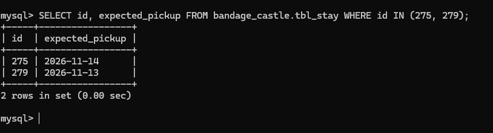

Departures och databasen visar rätt datum, stays visar en dag för tidig, därför blev jag förvirrad när jag såg att 279 ska hämtas idag i stays page, men i departures på homepage för FRONTDESK står det att den ska hämtas imorgon. Mer förrvirrande när 275 i stays ska hämtas imorgon, men inte finns med i departures för idag/imorgon.

Stayspage gör om datumet på fel sätt, symtom och orsak sitter inte alltid på samma ställe :D.
Alltså databasen har ett datum utan klockslag, API:t skickar det som midnatt svensk tid uttryckt i UTC (T23:00Z), och Stays klipper bort klockslaget med slice(0, 10) och får föregående dag

Jag jämförde API-svaret från /api/stays med databasen, SQL-frågan bekräftade det.

Jag hittade även att supplies länkar tar en till fel route, men ändrar ja i url:en till /supplies, kommer jag till supplies sidan som förväntat

Sen hämtning kostar även när man kommer i tid. lateDays i apps/api/src/legacy/billing/billing.ts gör `+ 1`, så hämtar man på expected pickup-dagen blir det 1 sen dag och avgift. Det finns ett test för just det i billing.test.ts, men det är avstängt med it.skip och en kommentar som skyller på tidszoner runt midnatt. Jag räknade med testets värden (pickup 5 okt, check-out 5 okt 16:30) och det faller hela tiden, inte bara vid midnatt. Någon gissade orsaken och stängde av testet, så buggen gömdes.

Misstänkt bugg, inte testad i appen än: personal med de nya rollerna stängs ute från delar av legacy.

checkAuth.ts i legacy sätter req.user.role till ADMIN om användaren har den rollen, annars till första rollen i listan. Routes i legacy, till exempel raven.routes.ts, reports.routes.ts och tournament.routes.ts, släpper bara igenom role === 'STAFF' eller 'ADMIN'. STAFF är den gamla personalrollen från före 2023. En användare som Pip Gatewarden har rollen FRONT_DESK och borde därför få 403 med meddelandet "no".

hasRole i packages/shared/src/roles.ts hanterar både STAFF och de nya rollerna, men legacy använder den inte.

Nästa steg: logga in som Pip och öppna Raven Post eller rapporterna för att bekräfta.

HITTADE NY INFO:
Supplies i menyn leder till fel adress. Menyvalet länkar till /supply, men routen i App.tsx heter /supplies. Skriver jag /supplies i adressfältet kommer jag till rätt sida.

Orsak: apps/web/src/nav/navConfig.ts har to: '/supply'. Rutorna på dashboarden länkar rätt till /supplies, så felet finns bara i menyn.
