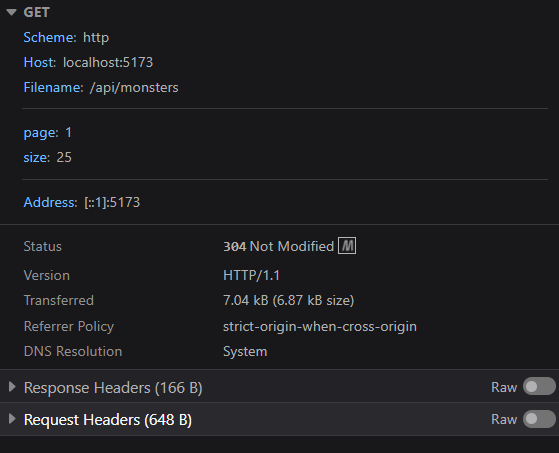
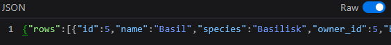

Steg 1:
Headers: 
Request: Inget
Response:  (Lista med monster osv)

Git bash:
HTTP/1.1 304 Not Modified
Vary: Origin
x-powered-by: Express
etag: W/"1ad7-QjIxbJoKwjmEXca9rU4XU/pkwEw"
date: Mon, 16 Nov 2026 10:46:14 GMT
connection: close

I terminalen med PRISMA_LOG="query":

[api] prisma:query SELECT `bandage_castle`.`tbl_user`.`id`, `bandage_castle`.`tbl_user`.`email`, `bandage_castle`.`tbl_user`.`password_hash`, `bandage_castle`.`tbl_user`.`role`, `bandage_castle`.`tbl_user`.`display_name`, `bandage_castle`.`tbl_user`.`created_at` FROM `bandage_castle`.`tbl_user` WHERE (`bandage_castle`.`tbl_user`.`id` = ? AND 1=1) LIMIT ? OFFSET ?
[api] prisma:query SELECT `bandage_castle`.`user_roles`.`user_id`, `bandage_castle`.`user_roles`.`role`, `bandage_castle`.`user_roles`.`created_at` FROM `bandage_castle`.`user_roles` WHERE `bandage_castle`.`user_roles`.`user_id` IN (?)
[api] prisma:query SELECT `bandage_castle`.`tbl_customer`.`id`, `bandage_castle`.`tbl_customer`.`user_id` FROM `bandage_castle`.`tbl_customer` WHERE `bandage_castle`.`tbl_customer`.`user_id` IN (?)

Loggen jobbar: log: process.env.PRISMA_LOG === 'query' ? ['query', 'warn', 'error'] : ['warn', 'error'],

Sista frågan: 304 eftersom kommandot skickade med webbläsarens ETag i If-None-Match. Utan den raden blir det 200 och hela listan.

19 sql frågor från monsters delen, men ingen av de handlar om just monster. För att Monster sql kommer från legacyn med mysql2, inte från prisma. Prisma visar sql som ligger i prisma.

Just för varför prisma är avslaget från början: brus, prestanda och säkerhet. Det är en vanlig princip. Detaljerad loggning slår man på när man felsöker något, och stänger av när man är klar.

Size för /monsters var 6.87 kB

Har öppnat /admin/audit och /admin/ravens som admin.
