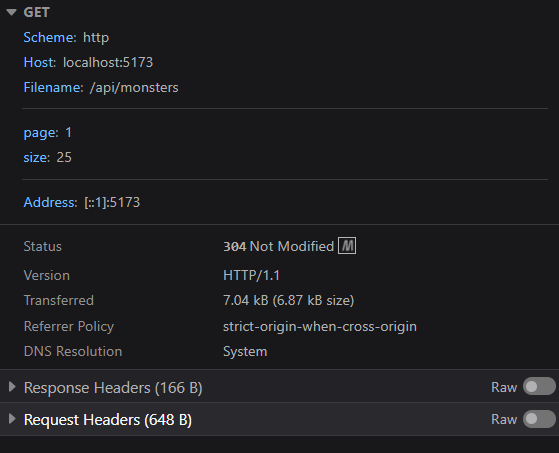
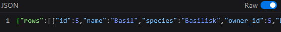

POST

GET

Går till apps/api/src/app.ts och bookingRouter

Status i network för min bokning är approved automatiskt, weird :p

Finns 4 post varianter, owner, frontdesk för aprove, decline och för owner cancel.

Stegen i bookingRouter för post:

Middleware 1: requireRole('OWNER')

- kollar inloggad (kastar 401) användare och om användaren har OWNER rollen specifikt (kastar 403)
  validera bookning

Middleware 2: validate(bookings.requestSchema)

- validerar bokningen enligt zodSchemat, nästa steg är antingen next med error eller next() som tar nästa middleware

Middleware 3: asyncHandler(async(req, res) => )

- Skickar vidare eventuella fel till errorHandler, uppstår inga fel så anropar den createRequest med objekten i fokus, alltså req.user.customerId, request bodyn och request userns id

Nästa bit är createRequest:
funktionen tar in objekten från tidigare del.

- Kollar om kunden har en profil
  -- Kastar 400
- Hämtar och kollar om monstret ägs av nuvarande kund i fokus
  -- Kastar 403
- Kör sql för att kolla om monstret har en bokning.
  -- Kastar 409
- Kör sql för att skapa boknings requesten

Anledning till varför boknings requests auto approvas.

- Kör sql för att hämta kunden
  -- Behöver inte kasta fel här eftersom första raden i funktionen fångar det

- Kollar om kundens email är owner@bandage.castle, är den det så approvas boknings requesten. Står att det ska städas upp efter lansering, bokningsförfrågan approvas av kunden själv och gäller bara lady grimsby.

Anropar approveRequest funktionen som gör:

- hämtar bokningsrequesten med sql
  -- Kastar 404
  -- Kastar 400 om bokningen inte har "pending" status
- Hämtar priser
  -- catch blir default: 10
- Skapar stay med alla nödvädiga värden
- Notifierar kunden att bokningen är godkänd och talar om när den ska komma osv.

Jag hoppar upp igen:

- Notifierar Frontdesk att bokningen finns OM den inte auto approvas, så i nuläget får frontdesk aldrig förfrågan om requests kommer från lady grimsby

Steg 5: 34 frågor totalt, inklusive automatiskt godkännande och omladdning. En vanlig kund får färre, eftersom ingen stay skapas.

Steg 6:

- BookStayPage kör send objektet med useMutation som visar ett meddelande att förfrågan antingen gått igenom eller inte och varför isåfall.

- Sidan uppdateras genom att React query använder nyckeln för booking-requests listan, då syns de förra och den nya som skapades, enklare sätt att ladda om automatiskt, jämfört med lairs reload funktion eftersom nu behöver sidan inte veta om vad som ska laddas om, bara att den här nyckeln är inaktuell, jämfört med reload.

Steg 7
17 sql frågor, efter omladdning av listan 23

- En useMutation kör post anrop: approve till /booking-requests/${id}/approve
  Vi hamnar i apiet, post anrop fångas upp
- Kollar korrekt role, alltså requireRole(...DESK)
- validerar enligt approveSchema
- asyncHandler anropar bookings.approveRequest
- De stegen inne i den har jag redan gått igenom ovan, under approveRequest i steg 4

transaction körs för att två saker händer, ett "created" objekt som innehåller stay objektet tekniskt sett, och booknings requesten måste uppdateras, som får stayId

Den behövs för att om ena failar så ska den andra inte kunna gå igenom, om en stay skapas men uppdatering failar så finns en stay och en bokningsförfrågan, och vise versa

<table>
  <tr><th></th><th>Skicka förfrågan</th><th>Godkänn</th></tr>
  <tr><td>URL och metod</td><td>POST /api/booking-requests</td><td>POST /api/booking-requests/:id/approve</td></tr>
  <tr><td>Komponent i webben</td><td>BookStayPage, send (useMutation)</td><td>BookingRequestsPage, approve (useMutation)</td></tr>
  <tr><td>Middlewares</td><td>requireRole('OWNER'), validate(requestSchema), asyncHandler</td><td>requireRole(...DESK), validate(approveSchema), asyncHandler</td></tr>
  <tr><td>Servicefunktion</td><td>createRequest</td><td>approveRequest</td></tr>
  <tr><td>Tabeller som skrivs</td><td>booking_requests, notifications (för Lady Grimsby även tbl_stay)</td><td>tbl_stay, booking_requests, notifications</td></tr>
  <tr><td>Antal SQL-frågor</td><td>34 med automatiskt godkännande och omladdning</td><td>17, eller 23 med omladdning</td></tr>
</table>
