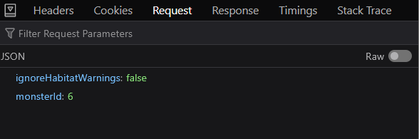
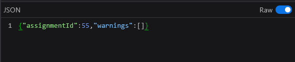
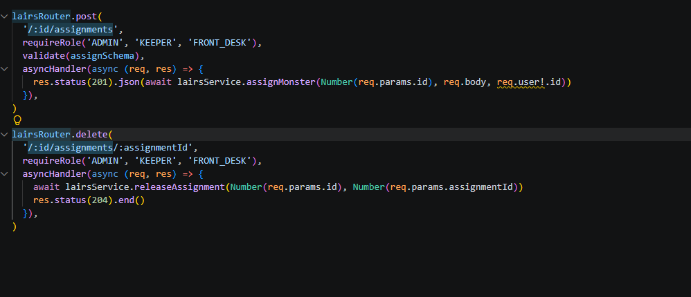
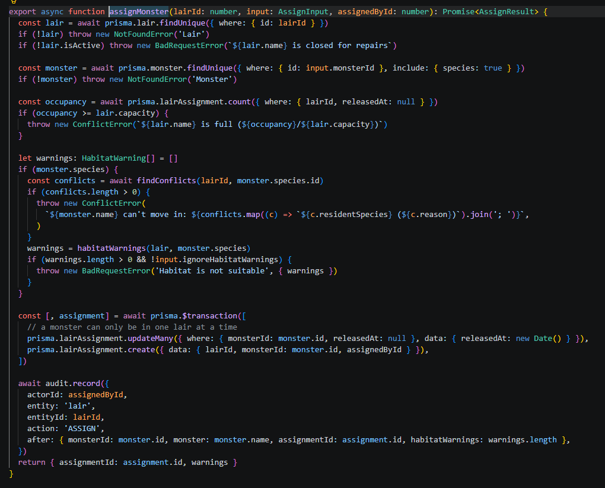
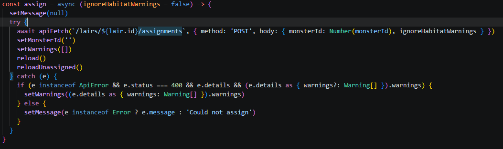
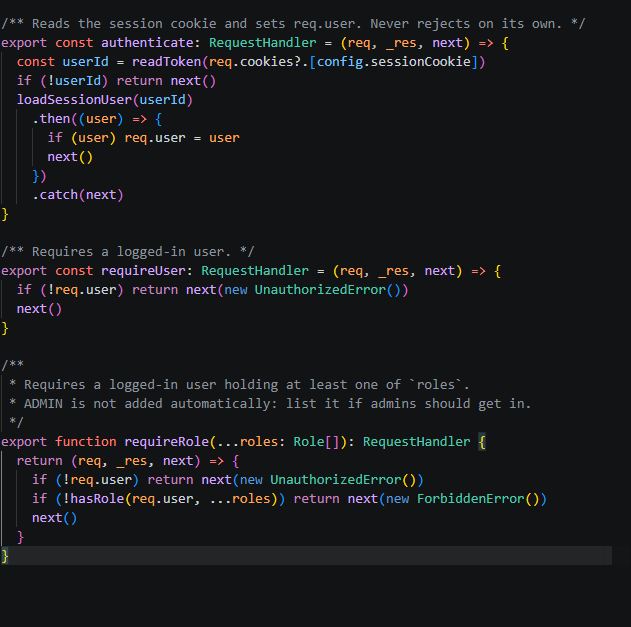

## Exempel: Placera ett monster i en lya

### Steg 1, klicket

 

### Svar på frågorna

19 frågor för POST och omkring 35 med omladdningen.
Inloggningen kostar 3 frågor per anrop, och klicket ger flera anrop.
När det blir ett problem: när databasen ligger på en annan server, med många användare, och värst om antalet växer med datan.
.NET: Network, breakpoints, LogTo för SQL, och .http-fil eller Swagger i stället för cURL.

### Steg 2, routern



! ser jag som beacon här, eftersom user redan är kontrollerad är det okej men ändå värt att observera.

### Steg 3, servicen

F12 på assignMonster tar mig till 

<table>
  <tr>
    <th>Kontroll</th>
    <th>Rad i koden</th>
    <th>SQL-fråga i terminalen</th>
    <th>Fel om den fallerar</th>
  </tr>
  <tr>
    <td>Finns lyan?</td>
    <td>prisma.lair.findUnique</td>
    <td>SELECT ... lairs</td>
    <td>404 NotFoundError</td>
  </tr>
  <tr>
    <td>Är lyan öppen?</td>
    <td>!lair.isActive</td>
    <td>Select ... Lairs, Id WHERE ISACTIVE True</td>
    <td>400 BadRequestError</td>
  </tr>
  <tr>
    <td>Finns monstret?</td>
    <td>prisma.monster.findUnique</td>
    <td>Select ... monsters WHERE ID ...</td>
    <td>404 NotFoundError</td>
  </tr>
  <tr>
    <td>Finns det plats?</td>
    <td>prisma.lairAssignment.count</td>
    <td>SELECT ... lairassignment, COUNT ... WHERE lairId, releasedAt null</td>
    <td>409 ConflictError</td>
  </tr>
  <tr>
    <td>Går arterna ihop?</td>
    <td>findConflicts(lairId, monster.species.id) -> prisma.lairAssignment.findMany</td>
    <td>SELECT (Many) ... WHERE lairId ... releasedAt: null, include monster SELECT speciesId ...</td>
    <td>409 ConflictError</td>
  </tr>
  <tr>
    <td>Passar habitatet?</td>
    <td>habitatWarnings</td>
    <td>Ingen egen select osv utan jobbar utifrån lair och monster som har sina selects...</td>
    <td>400 BadRequestError</td>
  </tr>
  <tr>
    <td>Transaktionen</td>
    <td>await prisma.$transaction</td>
    <td>lairAssignment UPDATE (many): WHERE monsterId ..., releasedAt null, data: releasedAt ... OCH lairAssignment CREATE: data: lairId, monsterId ..., assignedById</td>
    <td>400 ? hittar inte felet</td>
  </tr>
  <tr>
    <td>Audit</td>
    <td>await audit.record(</td>
    <td>vet inte</td>
    <td>vet inte</td>
  </tr>
</table>

Efter genomgång: "Är lyan öppen?" och "Passar habitatet?" gör ingen egen SQL-fråga. De kontrolleras i koden på data som redan är hämtad. Transaktionen och audit har ingen egen throw, så ett databasfel blir 500 via errorHandler.

### Steg 4, knappen



- Metoden assign, inga habitatErrors finns så den boolen sätts till false, nollställer Message alltså error för själva assignen, skild från HabitatError som har med monstret att göra. Nu tittar jag på error relaterat till assign.

- Metoden försöker göra ett fetch anrop till `/lairs/${lair.id}/assignments`
  Metod och Kropp: { method: 'POST', body: { monsterId: Number(monsterId), ignoreHabitatWarnings } })

- MonsterId, Warnings nollställs, reload metod som laddar om med useEffekt nästa tick, sen en reloadUnassigned som är samma reload? varför? Jo en reload laddar om lair med nuvarande ID i fokus och en annan "unassignedReload" laddar om listan med monster som inte har en lya

Glömmer man en reload nånstans så visas gammal data, nyare metoder använder useQuery där nyckel invalideras.

- Får vi ett error under tiden så slår catchen till och sätter warningar samt Message(Error)

### Steg 5, felvägen

Kommandot i Git Bash, med monsterId ändrat till "abc":

```
curl -i 'http://localhost:5173/api/lairs/9/assignments' \
-X POST \
-H 'Content-Type: application/json' \
-H 'Cookie: bc_session=<keeper-cookie>' \
--data-raw '{"monsterId":"abc","ignoreHabitatWarnings":false}'
```

(De övriga headers från Copy as cURL är borttagna här.)

```
keeper, "abc":  400 Bad Request  {"error":"Validation failed","details":{"formErrors":[],"fieldErrors":{"monsterId":["Expected number, received string"]}}}
```

Bonusfynd: trasig JSON gav 500 i stället för 400, eftersom errorHandler ignorerar statusen 400 från body-parser.

### Steg 6, behörighet

Samma kommando med Lady Grimsbys cookie, `bc_session=<owner-cookie>`:

```
owner, 6:      403 Forbidden  {"error":"You are not allowed to do that"}
owner, "abc":  403 Forbidden  {"error":"You are not allowed to do that"}
```

Servern kontrollerar först vem jag är, sedan vad jag skickar
{"error":"You are not allowed to do that"} är tydligare än legacy: "no"



Nedre delen i apps/api/src/middleware/requireRole.ts

funktionen requireRole kollar först inloggad användare, ger 401.
Kollar också om den inloggade användaren har rätt roll, ger 403 om inkorrekt roll.

### Steg 7, breakpoint

Variablerna: assignedById 3, monsterId och lairId
Stacken: requireRole, validate, asyncHandler och routen mellan Express och assignMonster
