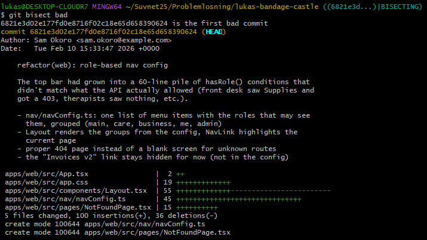

1.

Sista commiten för 2024: git --no-pager log --until=2024-12-31 -1 --oneline HEAD
Svar: afb852e Filter tickets by priority (#71)

2.

git bisect start
git bisect bad main
git bisect good afb852e
Bisecting: 50 revisions left to test after this (roughly 6 steps)
[61040e784e689309a64b4f6e2dea5fd5b3b2d079] feat(search): search the whole castle from the top bar

3.

git grep -n -i "to.*/suppl" -- apps/web/src/components apps/web/src/nav
apps/web/src/nav/navConfig.ts:25: { group: 'care', to: '/supply', label: 'Supplies', icon: '📦', roles: CARE },

4. 

Det tog 7 steg att komma hit med git bisect istället för typ 100 xD

Första dåliga commit av: Sam Okoro, länken skrevs som supply istället för supplies. När han flyttade alla länkar från Layout till en ny navconfig så skrev han fel på supplies
Lärdom: kontrollera stegen, eftersom git bisect litar blint på mig, hamnade i fel commit första försöket.

Det finns inga tester som kollar så att länkarna som finns hamnar på routesen som finns.

hash och datum för dålig commit: 6821e3d, 2026-02-10
