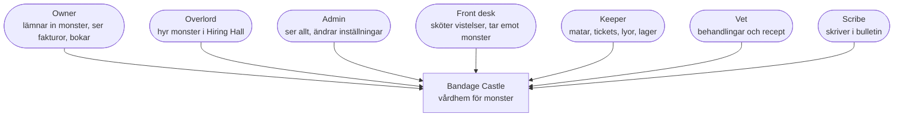
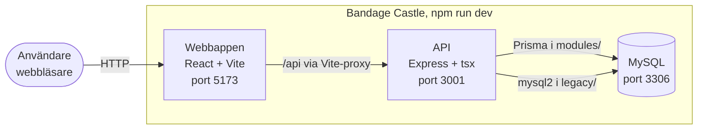

# 4.1 Fyra zoomnivåer

## Nivå 1: Kontext

Rollerna kommer från 1.3.

## Nivå 2: Containrar

npm run dev startar api och web samtidigt. Webben når API:t genom proxyn i vite.config.ts, som skickar allt som börjar med /api till port 3001. Porten till databasen står i DATABASE_URL i .env.

**Vilken nivå motsvarar Del 2?**
Nivå 3, komponenter. I Del 2 jämförde jag och förklarade filer och mappar inne i API:t och webbappen. Det är delarna inne i en container. Nu ritade jag nivå 1 med rollerna och nivå 2 med programmen.
