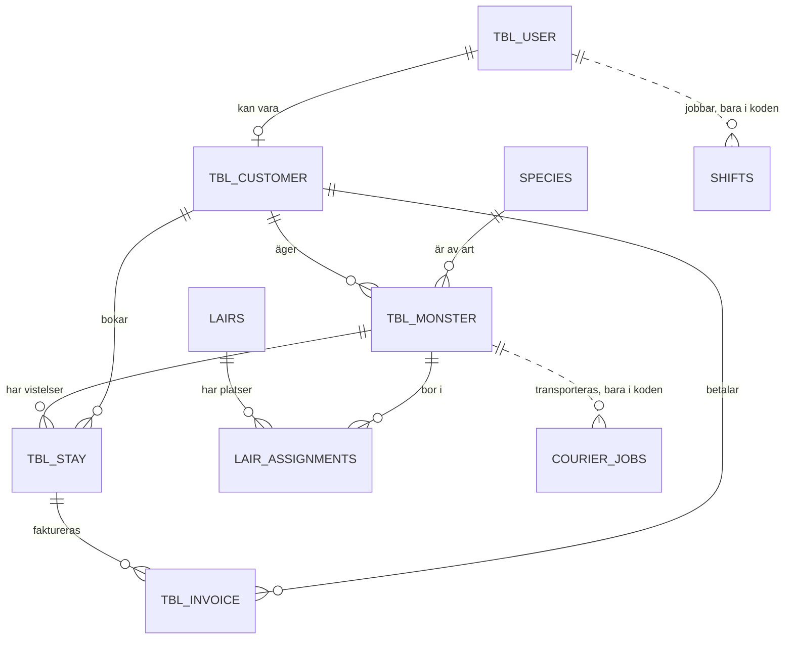

# 4.5 Datamodellen

Heldragen linje: sambandet finns i schemat med @relation. Streckad linje: fältet finns, men sambandet finns bara i koden.

**Tabeller från 2022**
tbl_user, tbl_customer, tbl_monster, tbl_stay och tbl_invoice. De nyare heter species, lairs, lair_assignments, courier_jobs och shifts.

**Främmande nycklar**
git grep -c "FOREIGN KEY" -- prisma/migrations gav inga träffar. Schemat kör med relationMode = "prisma". Kommentaren överst säger att legacy-tabellerna aldrig hade främmande nycklar, och att det skulle kräva att man först städar bort år av rader som pekar på saker som inte finns.

**Vem ser till att ett monster inte pekar på en kund som inte finns?**
Bara koden. Prisma-klienten kontrollerar sambanden när den används. @@index([ownerId]) gör bara sökningen snabbare, den skyddar inte. Legacy skriver SQL för hand med mysql2 och går förbi Prisma, så där kontrollerar ingen något.

**Ett fält där sambandet bara finns i koden**
Shift.userId pekar på en användare men har ingen @relation. CourierJob.monsterId och customerId pekar på monster och kund, men bara courierId har en @relation.
