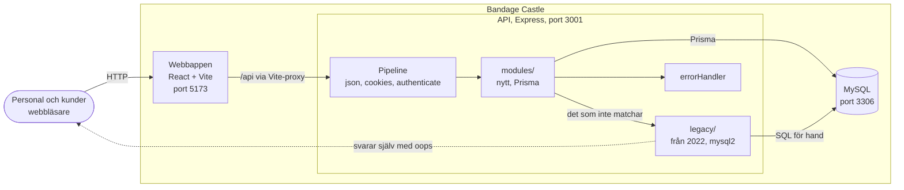

## 1. Översikt över övningarna

| Del   | Gjorda uppgifter                    | Inte gjorda, och varför            | Fördjupning som jag gjort |
| ----- | ----------------------------------- | ---------------------------------- | ------------------------- |
| Del 0 | 0.1–0.6                             |                                    |                           |
| Del 1 | 1.1–1.6                             | 1.7–1.11:                          |                           |
| Del 2 | 2.1, 2.2, 2.3                       | 2.4–2.8:                           |                           |
| Del 3 | 3.3, 3.4, 3.6, 3.7                  | 3.1, 3.2, 3.5, 3.8–3.10:           |                           |
| Del 4 | 4.1, 4.3, 4.5                       | 4.2, 4.4, 4.6–4.8:                 |                           |
| Del 5 | Exemplet, 5.1–5.4                   | 5.5–5.9:                           |                           |
| Del 6 | 6.1–6.8                             | 6.9:                               |                           |
| Del 7 | 7.1, 7.3, exemplet, 7.6, 7.10, 7.11 | 7.2, 7.4, 7.5, 7.7–7.9, 7.12–7.14: |                           |

Följer 50 % G för att hinna med.

---

## 2. Bandage Castle på en sida

### Arkitekturen

Sedan 4.1 vet jag mer: allt går genom samma pipeline, modules ligger före legacy i app.ts, och båda pratar med samma databas på två sätt. Legacy hoppar över errorHandler och svarar med "oops". Databasen har inga främmande nycklar, så bara koden håller ihop sambanden.

### Tidslinjen

| År        | Epok          | Vad hände                                                                                                                                                                                              |
| --------- | ------------- | ------------------------------------------------------------------------------------------------------------------------------------------------------------------------------------------------------ |
| 2022      | Lone wolf     | Gorm startade upp projektet och lade mycket grunder för sidan.                                                                                                                                         |
| 2023      | No I in team  | Gorm försvann. Priya och Tobias jobbade på sidan, med tester och mycket nya grejer som bytte ut eller flyttade kod.                                                                                    |
| 2024      | Billing v2    | Priya, Tobias och Morgan. Mycket billing. Morgan slutade i juli mitt i Billing v2, och från augusti 2024 till mars 2025 kom bara 3 commits. Det förklarar varför Billing v2 fortfarande inte är klart. |
| 2025–2026 | Modernisering | Priya och Sam. Sam bygger många nya funktioner, och Priya dokumenterar och flyttar gammal kod till Prisma.                                                                                             |

### Tre filer att läsa först

1. **apps/api/src/app.ts.** Hela pipelinen och alla routes på en sida. Ordningen förklarar varför modules vinner över legacy, och varför ett fel blir JSON eller HTML.
2. **prisma/schema.prisma.** Alla tabeller, vilka som är tbl_* från 2022, och vilka belopp som är koppar och vilka som är guld.
3. **docs/CONVENTIONS.md.** Reglerna teamet har bestämt, till exempel React Query, var ny kod ska ligga och att legacy är ett museum. Läs den innan du skriver något.

### Tre ställen att vara försiktig

1. **Pengar, apps/web/src/money.ts och legacy/billing.** Sju funktioner formaterar guld på olika sätt, och sex tabeller lagrar fortfarande guld som decimaltal. Fel enhet ger fel belopp på kundens faktura.
2. **legacy/.** SQL skrivs för hand, felen går förbi errorHandler och sökningen på O'Brien visade SQL injection. Små ändringar kan få stora följder.
3. **Inloggning och roller, middleware/requireRole.ts och legacy/middleware/checkAuth.ts.** Legacy jämför bara mot rollen STAFF och svarar 403 till front desk. Ett fel här stänger ute personal eller släpper in fel person.

### En förbättring av docs

docs/ARCHITECTURE.md ritar fortfarande Redis-cachen och säger att artsidan går genom cache.ts. ADR-008 tog bort cachen, och cache.ts finns inte. Utan cachen syns N+1-felet på artsidan, 74 frågor per anrop. Dokumentet borde ritas om utan Redis, med en rad om att artsidan behöver Priyas version med 3 frågor.

---

## 3. Reflektion

### Dokumentationen

Redan första dagen jämförde jag docs/ARCHITECTURE.md med ADR:erna, ändringsloggen och koden. ARCHITECTURE.md ritar en Redis-cache och säger att artsidan går genom cache.ts. Men ADR-008 tog bort cachen, och cache.ts finns inte i repot. Jag märkte det genom att söka efter filen och jämföra datumen på dokumenten.

Raven Post skulle ersättas av NotificationService enligt ADR-007, men koden finns kvar. NotificationService skickar fortfarande vidare till Raven Post, som jag såg i exemplet med #23. I 3.6 såg jag att legacy/README säger att customers fortfarande används, fast app.ts säger att modules/customers ersätter den. ADR-004 lovade att legacy skulle vara borta i slutet av 2023.

Att en ADR är ersatt betyder inte att ett annat dokument är fel, så jag fick jämföra datum och innehåll först. En ADR visar vad man bestämde, koden visar vad som hände. Nu kollar jag datum för när dokumentationen lades till, parallellt med att jag läser den.

### Claude Code

I 7.11 lät jag Claude Code skriva ett test för artsökningen i #7 och pusha det till grenen fix/species-search. När jag körde testet fick jag "No test files found". Jag hade själv skapat en gren med samma namn lokalt, så min gren saknade filen. Jag hämtade Claudes version med git pull origin fix/species-search, och då blev testet rött som det skulle.

I 5.3 gav Claude mig en sökning på lairsRouter.post('/:id/assignments') som inte gav någon träff, eftersom raden var uppdelad på flera rader. Jag testade själv och delade upp sökningen. DeepWiki, som jag testade första veckan, hamnade i seed-filen i stället för källkoden.

Nu ser jag till att testa det Claude ger innan något hinner gå ut. Går det ut kan värre saker hända än de små sakerna som hände här.

### Historiken

Varför tar Bandage Castle ut en förseningsavgift på avtalad dag? Koden visar bara att lateDays returnerar out.diff(pickup, 'days') + 1. Varför + 1 finns kunde jag bara ta reda på med historiken. git blame visade att Gorm skrev raden 2022-04-20 i en commit som bara hette "late fees", utan förklaring och utan test. Testet som visar felet stängdes av av Priya 2023-10-10, med en kommentar som hänvisar till Gorm, som hade slutat tio månader tidigare.

I 6.8 använde jag git bisect för att hitta när supplies-länken gick sönder. Första gången markerade jag commits som bad utan att testa, och hamnade på ADR-008. När jag testade varje steg landade jag på 6821e3d, där Sam Okoro bytte till navConfig 2026-02-10 och skrev /supply i stället för /supplies.

Koden visar vad som händer. Historiken visar varför och när. Utan historiken hade git bisect inte kunnat hjälpa mig att hitta vem som skrev felet och när.

### Från .NET

Det som skiljer mest är felhanteringen. I .NET fångas exceptions automatiskt, även i async-kod. I Express 4 måste asyncHandler fånga felet och skicka det vidare med next(err), annars hänger anropet, som jag läste om i Del 0. Typerna skiljer sig också. I TypeScript försvinner de när koden kör, så indata valideras för hand med zod. I Problemanalys 1.1 såg jag följden: ENABLE_BILLING_V2 var texten "false", och !! gjorde den till true. I .NET hade GetValue<bool> tolkat det rätt. Pengar räknas med number, som är ett flyttal, och därför blev 564.55 till 564.54 i formatGP. I C# hade jag använt decimal.

Det som var mer likt än jag trodde är pipelinen. Ordningen i app.ts, med authenticate före routrarna och errorHandler sist, fungerar som middleware i Program.cs. Prisma motsvarar EF Core, och requireRole motsvarar [Authorize(Roles = ...)].

Det jag tror att jag glömmer först är typerna. Det känns som att de inte behövs när koden ändå kör, men de finns bara när koden skrivs, och utan dem blir det rörigare. Det som kommer utifrån måste ändå valideras.

### Nästa kodbas

Dag 1 startar jag appen enligt README och antecknar var README inte stämmer, som i 1.1. Jag loggar in som olika roller och ser vad var och en gör, som i 1.3. Jag läser app.ts och mappstrukturen för att se vilka delar som finns.

Dag 2 följer jag ett klick från webben genom API:t ner till databasen och tillbaka, som i Del 5. Jag använder Network-fliken och PRISMA_LOG eller motsvarande för att se vilka anrop och frågor som görs.

Dag 3 läser jag historiken. git shortlog visar vilka som har jobbat där, och git log visar epokerna. Jag läser ADR:erna och jämför dem med koden, eftersom dokumenten inte alltid stämmer.

Nästa gång skulle jag lägga lite mer tid på varje del av ett nytt repo.
